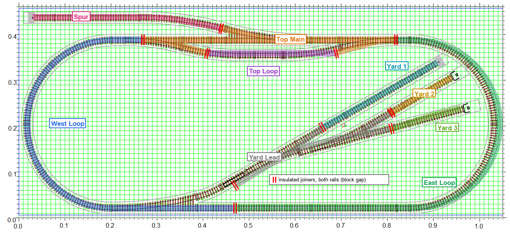

# Block plan for occupancy detection

Where the layout is divided into detection blocks, where the insulated
joiners go, and how the blocks are wired. Coordinates are metres on the
track plan's grid and are approximate; on the real track, put each pair of
insulated joiners at the first rail joint past the turnout frog.

## Blocks

Three blocks round the oval (no close following needed), the passing loop
and the spur, then the yard.

| No. | Block | Extent | Approx length |
|---|---|---|---|
| 1 | West Loop | Top main at x≈0.27, round the west curve, along the bottom to just past the yard turnout frog at x≈0.47. Includes the yard turnout. | 1.0 m |
| 2 | Top Main | Through road from x≈0.27 to x≈0.82, including all three top turnouts and their diverging legs out to the frogs | 0.5 m |
| 3 | East Loop | Top main at x≈0.82, round the east curve, along the bottom to x≈0.47 | 1.2 m |
| 4 | Top Loop | The y≈0.37 passing track between the two siding frogs | 0.27 m |
| 5 | Spur | The y≈0.44 track from the spur turnout frog to the bumper at x≈0.03 | 0.4 m |
| 6 | Yard Lead | From the yard turnout frog on the bottom main, up the diagonal, including both yard turnouts | 0.45 m |
| 7 | Yard 1 | Upper road, ending at the bumper near (0.91, 0.35) | 0.35 m |
| 8 | Yard 2 | Middle road, ending near (0.95, 0.31) | 0.2 m |
| 9 | Yard 3 | Lower road, ending near (0.97, 0.25) | 0.2 m |

Wire blocks 1–5 first: they are enough for signalling the main line and
the passing loop. The yard follows; if detector channels are short, start
with the lead alone, since it is the shared headshunt.

If close following on the oval is ever wanted, one more pair of insulated
joiners at x≈0.92 on the bottom straight splits East Loop into an east
curve and a bottom main without any other rewiring.

## Gaps

Every turnout belongs to the block at its point end. The insulated joiners
go just past the frog on both legs, both rails:

| Gap | Where | Between |
|---|---|---|
| 1 | Top main, x≈0.27 | West Loop / Top Main |
| 2 | Top main, x≈0.82 | Top Main / East Loop |
| 3 | West end of the passing track, x≈0.41 | Top Main / Top Loop |
| 4 | East end of the passing track, x≈0.69 | Top Loop / Top Main |
| 5 | Spur, just past the spur turnout frog, x≈0.44 | Top Main / Spur |
| 6 | Bottom main, x≈0.47 | West Loop / East Loop |
| 7 | Yard lead, just past the yard turnout frog, (0.47, 0.08) | West Loop / Yard Lead |
| 8 | Upper branch past the first yard turnout, (0.66, 0.20) | Yard Lead / Yard 1 |
| 9 | Middle branch past the second yard turnout, (0.81, 0.24) | Yard Lead / Yard 2 |
| 10 | Lower branch past the second yard turnout, (0.81, 0.20) | Yard Lead / Yard 3 |

## Wiring

- All #4 turnouts are set to **non-power-routing** (selector screws under
  the turnout), so both legs beyond every frog are always live from the
  turnout's own feed. The insulated joiners do the isolation, not the
  turnout.
- Gap **both rails** at every block boundary (Kato 24-816 insulated
  joiners).
- Every block has its **own feeder**, wired through its detector channel.
  No block picks up power through a turnout.
- Current detection only sees the locomotive. Fit a resistor wheelset to
  the last vehicle of each train so the tail holds the block.

## JMRI

JMRI's MQTT sensors publish `ACTIVE` / `INACTIVE` on
`<channel>track/sensor/<name>`. When the detector node is commissioned,
give it a numeric sensor range in
[`MQTT_CONVENTIONS.md`](MQTT_CONVENTIONS.md), the same way turnout nodes
own a block of 100, and name the JMRI blocks as in the table above.
